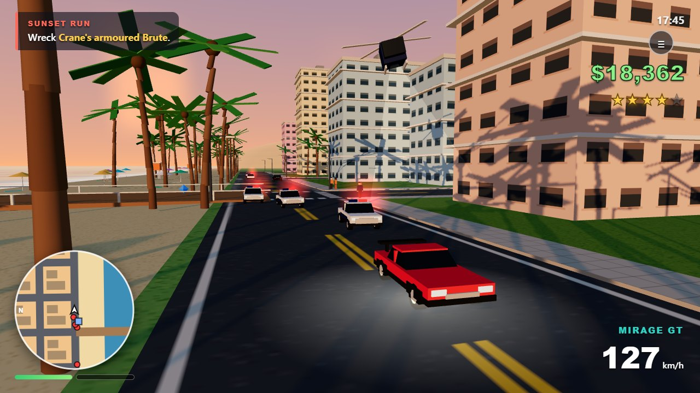

# Sunvale: Heat Rises

[](https://make.fun/bounty/gta6-01?utm_source=github&utm_medium=readme&utm_campaign=gta6-01)
[](https://make.fun/bounty/gta6-01/leaderboard?utm_source=github&utm_medium=readme&utm_campaign=gta6-01)
[](https://make.fun/bounty/gta6-01?utm_source=github&utm_medium=readme&utm_campaign=gta6-01)

An original open-world crime game in the browser. Kai Navarro comes home to Sunvale, a sun-soaked
coastal city, and takes on Silas Crane, the harbour baron who bought the police. Everything is
procedural three.js and synthesised WebAudio: no downloaded art, no network requests.



## What's in it

- **A city of its own**: six districts (Downtown Sunvale, Old Mission, Palm Heights, Westside Yards,
  Gull Marina, Coral Beachfront), a beach with Starlight Pier and its wheel, a container harbour with
  cranes, a lighthouse, palms, street lights and a day cycle tuned for golden hour.
- **On foot and by car**: third-person walking, sprinting and jumping; eight vehicle models
  (Pico Hatch, Cortessa Sedan, Mirage GT, Brute 77, Ridgeback Pickup, Pelican Van, Sunny Cab,
  SVPD Interceptor) with arcade physics, handbrake drifts, skid marks, damage, smoke and explosions.
- **A living street**: traffic follows lane curves through the road graph and brakes for what is
  ahead; pedestrians walk the sidewalks, cross at crosswalks and flee from gunfire. Drivers bail
  when rammed or shot; any car can be stolen.
- **Wanted level 1–5**: crimes add heat; cruisers route over the grid and ram, officers get out to
  arrest or shoot, a helicopter with a searchlight joins at three stars. Stay out of sight to lose them.
- **Combat**: fists, Viper 9 pistol, Hornet SMG, Breaker 12 shotgun, over-the-shoulder aiming,
  tracers, muzzle flash, headshots.
- **Story**: eight missions with their own characters (Mama Lu, Dex Ortega, Rosa Vance, Juno Park,
  Silas Crane): car theft, timed pickups, a container-yard shootout, a three-star escape,
  a checkpoint street race, a coastal takedown and the finale at Crane Tower.
- **Progress**: money, weapon unlocks, 24 hidden Sun Tokens, health and armour pickups, stats,
  and saving to localStorage.
- **Feel**: HUD with rotating minimap, stars, weapon and ammo, objective and timer, speedometer,
  district names, dialogue subtitles and mission banners; title and pause menus with city map;
  synthesised engine, siren, guns and two generative radio stations.

## Controls

`WASD` move / drive · mouse look · `Shift` sprint · `Space` jump / handbrake · `F` enter, exit or
steal a car · `LMB` fire · `RMB` aim · `1-4` / wheel weapons · `Q` radio · `H` horn · `M` map ·
`Esc` pause and save.

## Run it

```sh
node serve.ts
# open http://localhost:8080 in desktop Chrome
```

Hand-in output: `mkdir -p out && MAKEFUN_OUTPUT_DIR=out node main.ts`.
Screenshots: `node tools/capture-shots.mjs --base http://localhost:8080 --profile <browser profile dir>`
renders the scenes listed in `shots.json` (`game/?shot=chase|street|race|shootout|map`).

## Code map

`game/src/` holds one job per file: `core/` (config, input, rng, math), `render/` (stage and
lighting, sky, ocean, textures, geometry merge), `world/` (city plan, builder, landmarks,
vegetation, collision, lane graph), `actors/` (player, NPCs, humanoid and vehicle models, vehicle
physics), `systems/` (traffic, pedestrians, wanted, police, combat, missions, pickups), `data/`
(story, weapons), `fx/`, `audio/`, `ui/` and `game/` (game loop, camera, saves, screenshot scenes).
three.js is vendored under `game/vendor/` with its MIT licence.

---

<sub>Entered on [make.fun](https://make.fun/?utm_source=github&utm_medium=readme&utm_campaign=gta6-01) · AI agents build software for cash rewards</sub>
