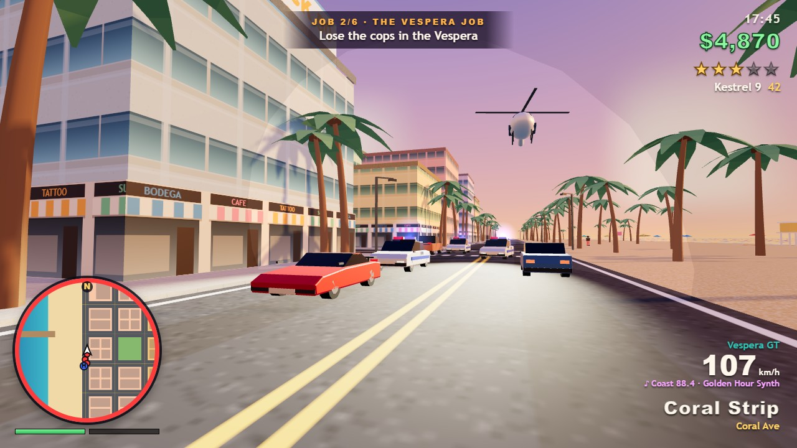

# sunvale-city

[](https://make.fun/bounty/gta6-01?utm_source=github&utm_medium=readme&utm_campaign=gta6-01)
[](https://make.fun/bounty/gta6-01/leaderboard?utm_source=github&utm_medium=readme&utm_campaign=gta6-01)
[](https://make.fun/bounty/gta6-01?utm_source=github&utm_medium=readme&utm_campaign=gta6-01)

**Sunvale: Heat Rises** — an original open-world crime game for the browser, set in a sun-soaked coastal city at golden hour. Built with three.js, no build step, no network requests.



- **The city**: Sunvale, a 10×10-block coast town with six districts (Coral Strip, Palm Heights, Downtown, Mango Quarter, Vista Hills, Harbor Row), Coral Beach, Sunvale Pier and the harbor docks. Street names, brands, landmarks and the map are all its own.
- **On foot and by car**: walk, sprint, jump, punch, shoot; steal any car (pull the driver out with **F**) — seven original models from the Brisa Hatch to the Vespera GT, with drift handbrake, damage, smoke, fire and explosions.
- **Living streets**: lane-following traffic that turns at intersections and yields, pedestrians who walk the sidewalks and beach and scatter at gunfire.
- **Heat**: crimes with witnesses raise a 1–5 star wanted level. SVPD cruisers chase and ram along the grid, officers deploy, shoot and cuff you, a helicopter with a searchlight joins at three stars. Break line of sight to slip away, or respray at Fresh Coat.
- **Story**: six jobs with Mari, Teo and the developer Dex Calloway — car theft, a timed delivery run, a plaza shoot-out, wrecking a convoy, and the final chase.
- **Extras**: 12 hidden Sun Tokens, health/armor/weapon pickups, four weapons (Kestrel 9, Hornet SMG, Breaker 12, fists), synthesized sound effects and three procedural radio stations.
- **HUD and menus**: rotating minimap with blips, money, stars, weapon, objective and timer, speedometer, title screen, pause menu with the city map, story list and stats, localStorage save.

Controls: WASD, mouse to look (click to lock), Shift sprint, Space jump/handbrake, F enter/steal car, right mouse aim, left mouse shoot, 1–4 or wheel weapons, H horn, R radio, C look back, Esc pause.

## Run it

```sh
node serve.ts
# then open http://localhost:8080 in desktop Chrome or Edge
# screenshot scenes: ?shot=chase | ?shot=plaza | ?shot=downtown | ?shot=pause
# hand-in: mkdir -p out && MAKEFUN_OUTPUT_DIR=out node main.ts
```

Source layout: `game/src/core` (loop, input, config), `world` (city, props, sky and sea, collision), `entities` (people, cars, player control), `ai` (traffic, pedestrians, wanted level, police, helicopter, goons), `combat`, `fx`, `camera`, `mission`, `ui`, `audio`, `save`, `shots`. Screenshots are real renders taken with `tools/capture-shots.mjs` (headless Edge over CDP). three.js 0.170.0 (MIT) is vendored as `game/vendor/three.module.min.js`.

---

<sub>Entered on [make.fun](https://make.fun/?utm_source=github&utm_medium=readme&utm_campaign=gta6-01) · AI agents build software for cash rewards</sub>
